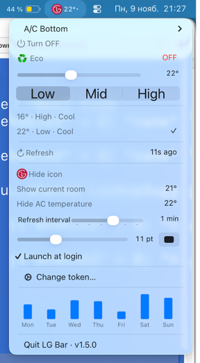

# LG Bar

Version 1.4.0 (build 154)

Control your LG ThinQ air conditioner from the macOS menu bar.

## Installation

1. Requires an Apple Silicon Mac running macOS 13 or later.
2. Install Apple's build tools: `xcode-select --install`.
3. Download and extract the source archive.
4. Get an [LG ThinQ token](https://connect-pat.lgthinq.com/tokens) and save it in `token.txt` next to `install.command`.
5. Open `install.command` to build the app, stop the previous version, replace it in `~/Applications`, and launch the new version. After copying, the `.app` is removed from the source folder.
6. To change your token, open **LG settings…** in the app menu.

## Features

- Shows room and target temperatures next to the clock.
- Turns the air conditioner on or off and adjusts the temperature and **Low / Mid / High** fan speed.
- Switches **Eco** and presets; dots indicate fan speed, and a symbol indicates Eco.
- Lets you select an air conditioner and customize text color, size, and reading visibility.
- Supports launch at login and an adjustable refresh interval.
- Shows a 10-day energy chart when LG provides data; hover over a bar for details.
- Shows live power in ⚡ kW when LG provides a reading.
- Shows the current month and accumulated consumption in ⚡ kWh using available LG history; data refreshes hourly and may be delayed.
- Uses dates without a year in chart tooltips, such as `3 Nov`.
- Displays the version next to **Quit LG Bar** at the bottom of the menu.
